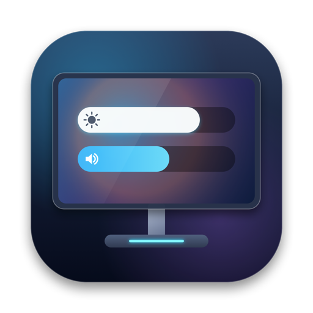

<div align="center">
  
  <h1>MateView GT Control</h1>
  <p><strong>Native macOS Control Center for HUAWEI MateView GT (2026 / QSN-CBB) & Apple Silicon MacBooks</strong></p>
  <p>
    
    
    
    
  </p>
</div>

---

## 简介 (Overview)

**MateView GT Control** 是一款专为 **华为 MateView GT（2026 款 27 英寸 4K 160Hz / `HWV QSN-CBB`）** 与 **Apple Silicon Mac (MacBook Air / Pro / Mac mini / Studio)** 打造的轻量级 macOS 原生菜单栏硬件控制组件。

通过直接与 Apple Silicon 底层 `DCPAVServiceProxy` (`IOAVServiceReadI2C` / `IOAVServiceWriteI2C`) 通信，不仅支持标准 VESA MCCS VCP 指令，更**逆向打通了华为私有 3 字节扩展 DDC/CI 寄存器（`0xF8 0xE1 <SubCode>`）**，无需伸手拨动显示器底部五向摇杆，即可在 macOS 右上角控制中心一键完成硬件级控制。

---

## 核心特性 (Key Features)

- **硬件级亮度与实时尼特显示 (`VCP 0x10`)**：
  - 依据 MateView GT 2026 款光学曲线（`35 nits ~ 450 nits`）实时换算并显示物理尼特值与 `0-100` 档位。
  - 内置 `夜间` / `阅读` / `办公` / `峰值` 四档场景快捷切换。
- **双屏独立零闪烁键盘快捷键 (`F1 / F2` & `Option + F1 / F2`)**：
  - 结合 `IOHIDFamily` 驱动级按键映射 (`hidutil`) 与 `Carbon EventHotKey`，**鼠标在哪个屏幕，亮度键就独立控制哪个屏幕**（支持 `MateView GT` 与 `MacBook Air 内建视网膜屏幕` 完全分离调节，零回滚闪烁，按住 `Option` 键支持 `±1` 级微调）。
- **智能扬声器检测与硬件音量调节 (`VCP 0x62` / `0x8D` & `CoreAudio`)**：
  - 自动检测当前 macOS 默认输出设备，面板内一键切换 `[显示器 | 内置]` 扬声器；按 `F10 / F11 / F12` 自动控制当前发声设备，按住 `Option` 键支持 `±1` 精细步进。
- **华为私有扩展寄存器直驱：电子书（黑白 / 彩墨）与 P3 / sRGB 模式 (`Ext 0xF8E157`)**：
  - **P3 广色域** / **sRGB 标准** / **电子书 · 黑白（0 饱和纯硬件墨水屏）** / **电子书 · 彩墨绘本** 一键切换。
  - 支持硬件自带色温（`暖色 6500K` / `标准` / `冷色 9300K` / `自定义 R/G/B 硬件增益`）及按模式独立记忆的 **彩墨度 (`0-20`)、对比度 (`0-100`)、4K 字体锐度 (`0-100`)** 微调。
- **苹果官方原生 160Hz HiDPI 缩放一键切换 (`CoreGraphics`)**：
  - 直接调用系统原生 2× Retina 帧缓冲模式（`1080P` / `2.3K` / `2K` / `3K` / `4K` @ `160Hz`），零虚拟屏幕开销，完美替代 BetterDisplay。
- **双屏同步护屏、定时自动息屏与深色模式联动**：
  - 支持 `15m / 30m / 45m / 60m` 两段式闲置护屏（先降暗背光 -> 超时切断物理背光 `VCP 0xD6 = 0x04` 及内建屏幕 `0.0` 背光，看视频/开会时自动识别 `IOPMAssertion` 防误关）。
  - 支持开机自启、历史设置自动持久化以及睡眠唤醒 / 热插拔自动写回硬件。

---

## 下载与编译安装 (Install & Build)

### 方式一：直接下载 `.pkg` 安装包 (v0.1)
可直接从 [GitHub Releases (v0.1)](https://github.com/ruoshui6662/MateView-GT-Control/releases/tag/v0.1) 或仓库目录 [`dist/MateView-GT-Control-v0.1-Installer.pkg`](dist/MateView-GT-Control-v0.1-Installer.pkg) 下载安装包，双击即可安装至 `/Applications/MateView GT Control.app` 并自动启动。

### 方式二：从源码编译
- **环境要求**：macOS 13.0+ (Apple Silicon M1/M2/M3/M4)，Xcode Command Line Tools

```zsh
# 1. 编译 MateView GT Control.app (输出至 dist/)
zsh Scripts/build_app.sh

# 2. 打包 MateView-GT-Control-v0.1-Installer.pkg (输出至 dist/)
zsh Scripts/build_pkg.sh
```

---

## 目录结构 (Project Structure)

```text
mateviewGT/
├── LICENSE                                       # MIT 开源许可证
├── README.md                                     # 项目说明文档
├── Package.swift                                 # Swift Package Manager 清单
├── Resources/
│   └── logo.png                                  # 应用高清 Logo 预览
├── Scripts/
│   ├── generate_icon.swift                       # CoreGraphics 矢量图标生成器 (AppIcon.icns & MenuBarIcon)
│   ├── build_app.sh                              # 编译并打包 MateView GT Control.app (v0.1)
│   └── build_pkg.sh                              # 构建 MateView-GT-Control-v0.1-Installer.pkg
├── dist/
│   └── MateView-GT-Control-v0.1-Installer.pkg    # v0.1 预编译 macOS 安装包
└── Sources/
    ├── CBridge/                                  # Apple Silicon 底层 I2C/DDC、CoreAudio、DisplayServices 桥接层
    │   ├── include/
    │   │   └── IOAVServiceBridge.h
    │   └── IOAVServiceBridge.m
    └── MateViewGTApp/                            # SwiftUI + AppKit 原生菜单栏应用层
        ├── MateViewGTApp.swift                   # 应用入口、状态栏图标与无边框控制中心面板管理
        ├── Hardware/
        │   ├── HuaweiDDCEngine.swift             # 华为标准/3字节扩展 DDC 引擎、双屏同步护屏与历史设置恢复
        │   ├── HiDPIManager.swift                # macOS 原生 160Hz HiDPI 分辨率缩放管理器
        │   ├── MediaKeyInterceptor.swift         # 零闪烁双屏独立亮度/音量快捷键引擎
        │   └── LaunchAtLoginManager.swift        # 开机自启管理器
        └── UI/
            ├── LiquidGlassTheme.swift            # macOS 原生毛玻璃卡片、分段控制器与胶囊滑块组件
            ├── ControlPanelView.swift            # 四区统一控制中心主界面
            └── LiquidHUDWindow.swift             # 屏幕底部亮度(尼特)/音量原生 HUD 浮层
```

---

## 华为 MateView GT (QSN-CBB) 已验证 VCP 寄存器速查表

| 寄存器编码 | 类型 | 取值范围 | 功能说明 |
| :--- | :--- | :--- | :--- |
| `0x10` | 标准 1-Byte | `0 ~ 100` | 物理背光亮度（对应 `35 ~ 450 nits`） |
| `0x12` | 标准 1-Byte | `0 ~ 100` | 硬件对比度 |
| `0x14` | 标准 1-Byte | `0x05`(暖色 6500K), `0x06`(标准), `0x08`(冷色 9300K), `0x0B`(自定义 RGB) | 硬件自带色温模式 |
| `0x16 / 0x18 / 0x1A` | 标准 1-Byte | `0 ~ 100` | 自定义色温下的 R / G / B 硬件增益 |
| `0x60` | 标准 1-Byte | `0x0F`(DP), `0x11`(HDMI1), `0x12`(HDMI2), `0x15`(Type-C) | 输入信号源切换 |
| `0x62` | 标准 1-Byte | `0 ~ 100` | 内置扬声器硬件音量 |
| `0x87` | 标准 1-Byte | `0 ~ 100` | 4K 硬件锐利度 (Sharpness) |
| `0x8D` | 标准 1-Byte | `0x01`(静音), `0x02`(取消静音) | 内置扬声器硬件静音 |
| `0xC0` | 标准 1-Byte | 只读 (Hours) | 显示器硬件累计点亮时长 |
| `0xD6` | 标准 1-Byte | `0x01`(唤醒), `0x04`/`0x05`(硬件省电待机) | 物理背光电源管理 |
| `0xF8 0xE1 0x57` | 华为扩展 3-Byte | `0 ~ 20` (`0`=纯黑白电子书, `6`=彩墨绘本, `10`=原彩) | 硬件全局色彩饱和度 (Scaler 直驱) |
| `0xF8 0xE1 0x51` | 华为扩展 3-Byte | `0 ~ 2` | 160Hz Overdrive (OD) 液晶响应速度 |
| `0xF8 0xE1 0x11` | 华为扩展 3-Byte | `0 ~ 5` | 暗阶增强 (Black Equalizer) |

---

## 开源协议 (License)

本项目基于 [MIT License](LICENSE) 开源。
